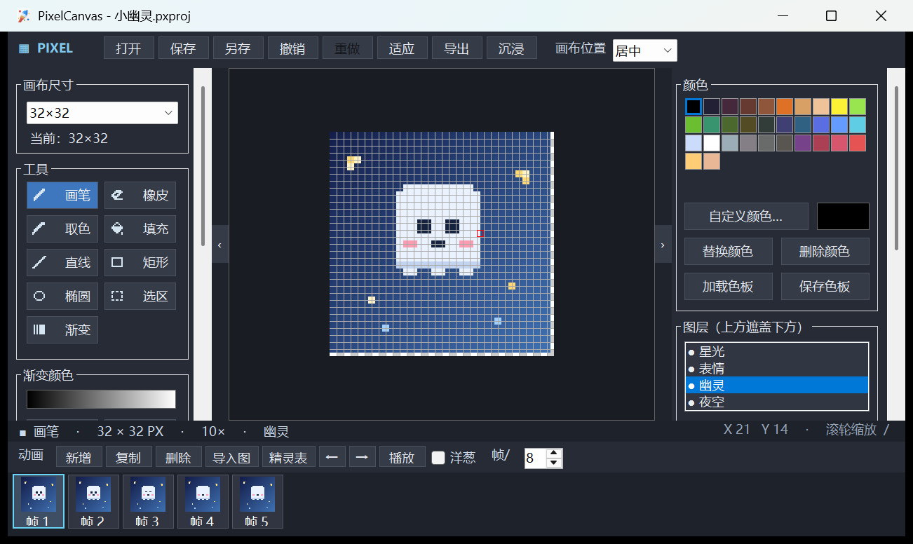
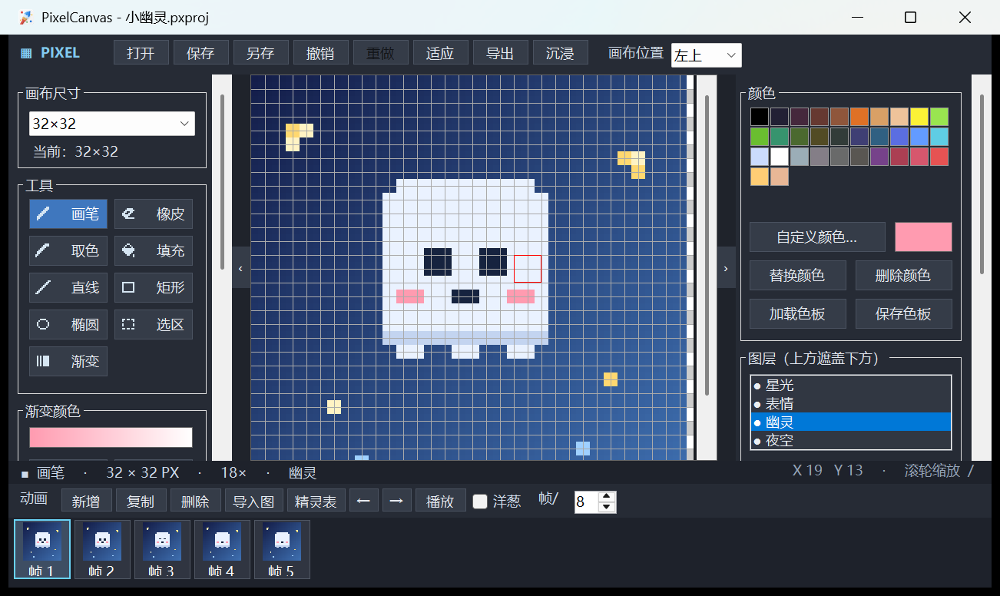

# PixelCanvas 像素画布

## 功能简介

原生 Windows 桌面像素画工具（C# WinForms / .NET 10），核心逻辑与无头 MCP 服务为跨平台 `net10.0` 库，可在 Linux/macOS 构建并运行文件级工具与导出；实时画布宿主仍依赖 Windows 桌面：

- 画布：默认 32×32；预设 8/16/32/64/128/256/512；支持自定义 4–512（可非正方形），透明格显示棋盘格。
- 工具：画笔（B）、橡皮（E）、取色器（I）、油漆桶（G）、渐变（D），以及直线、矩形、椭圆和选区；画笔大小 1–4，右键可快速取色。
- 渐变：当前颜色为起始色，可设置结束色并交换两色；在连续同色区域内拖动确定方向和范围，支持镜像与撤销。
- 本地 MCP：支持连接正在运行的画布或操作工程文件，配置和工具说明见 [MCP.md](MCP.md)；Windows 下暴露 8 个分组工具（`canvas` / `layers` / `settings` / `animation` / `draw` / `files` / `project` / `tool_info`），78 个操作按组收敛在各自的 `action` 枚举里，旧名称仍可直接调用；Linux/macOS 无实时画布宿主，只暴露 `project` 与 `tool_info` 两个工具。分组描述采用“用途 + 动作名 + 示例”的紧凑格式，完整参数由 `pixelcanvas_tool_info` 按需查询；省略 `canvas_` / `project_` 前缀且唯一匹配时可直接调用，选错分组或拼错动作会返回所属工具与候选建议。
- 调色板：内置 32 色 DawnBringer（DB32）+ 自定义颜色（系统原生取色器）。
- 对称绘制：水平镜像 / 垂直镜像独立开关，可同时开启（一点对称 4 点）。
- 图层：最多 32 层，支持新建、删除、调整顺序和显示 / 隐藏；隐藏的图层不能绘制。
- 帧动画：底部可新增、复制、删除帧，导入同画布尺寸的 PNG、JPEG 或 BMP 作为新帧，并以 1–60 帧/秒循环播放；每帧拥有独立图层。最多 128 帧，多帧总图层像素不超过 2200 万。导入的半透明像素会转换为透明或不透明。
- 动画时间轴：点击缩略图切换帧，拖动或使用左右按钮调整顺序（排序可用 Ctrl+Z 撤销）；可开启洋葱皮，以红色和蓝色显示前后帧。洋葱皮仅供编辑参考，播放及导出时不显示。
- 精灵表：动画栏点击“精灵表”，设置每行帧数，按当前导出放大倍数将全部帧依次导出为透明 PNG 网格。
- 导出预设：右侧“导出设置”可保存和复用 PNG、GIF、精灵表的缩放、GIF 帧率、精灵表列数及输出目录；按预设导出会创建新文件，GIF 预设帧率不修改工程帧率。
- 颜色管理：可替换当前帧当前图层中的一种颜色（可撤销），并删除调色板颜色、保存及加载 `.pxpal` 色板；调色板随 `.pxproj` 工程保存。
- 撤销 / 重做：Ctrl+Z / Ctrl+Y（或 Ctrl+Shift+Z），每个图层最多 100 步，一整笔一步；所有图层的历史共用 64 MiB 上限，超限时最早的记录会被移除。结构与像素共用同一条动作链：帧的新增、复制、导入、删除、排序、批量加帧，以及图层的新增、删除、排序、显隐切换各记一步结构快照（最多 32 步，按网格估算占用另设 64 MiB 预算）；撤销按全局动作先后推进，命中非当前帧时自动切换过去。
- 工程保存 / 载入：Ctrl+S / Ctrl+O，`.pxproj`（UTF-8 JSON，按行 RLE 像素编码）；多帧工程保存全部帧、图层和帧率，并可读取旧版单帧工程。旧版程序无法打开多帧工程。
- 工程文件上限：256 MiB，调色板最多 1024 色；超限时会提示错误并保留现有文件。旧版工程同样适用此上限。
- 自动保存与恢复：未保存的修改每分钟写入独立恢复副本，并在副本旁写入像素撤销历史（`.undo`）；异常退出后下次启动可恢复，恢复后 Ctrl+Z 仍可回退到崩溃前若干步，需手动保存工程。
- 参考图：打开本地图片作为画布底图，可调整不透明度和显示状态；参考图不会保存在工程中或出现在导出的 PNG 中。
- 沉浸画图：F11 进入或退出全屏画布，Esc 退出；F1 查看全部快捷键，F2 查看当前画布和工具状态。
- 导出 PNG：1×–16× 最近邻放大，无网格线、透明背景保留。
- 导出 SVG：把当前帧的可见图层写成矢量色块，相邻同色像素合并为矩形，透明留空；任意缩放不失真，便于排版或继续在矢量软件里编辑。
- 导出序列帧：动画栏“序列帧”把全部帧逐张写成 PNG（`frame-001.png`…）到动画目录下的新文件夹，默认沿用当前导出倍数，不覆盖已有文件。
- 导出 GIF：多帧画布的导出对话框默认选择循环 GIF，保存到动画文件夹；支持透明背景和 1×–16× 最近邻放大。导出前可选调色板：自动模式最多 255 色、超出时量化；工程调色板模式把 1–255 色按顺序写成固定索引色，画面外颜色映射到最近色，透明固定索引 0。普通工程保存仍为可编辑的 `.pxproj`。
- 其他：网格线开关、悬停笔刷高亮、整数倍自动缩放（高 DPI 支持）。

## 界面预览

32×32 四图层工程：左侧工具与画布尺寸，中间画布，右侧调色板与图层列表，底部帧时间轴。



放大到 18× 并开启网格，可以看到逐像素绘制与取色的精度：



同一工程的 5 帧眨眼动画，由 `canvas_export_gif` 以 8× 放大导出：


## 构建命令

需要 .NET 10 SDK（可在 [dotnet.microsoft.com](https://dotnet.microsoft.com) 下载，或 `winget install Microsoft.DotNet.SDK.10`）。版本号由根目录 `Directory.Build.props` 集中管理，桌面程序、MCP 服务与插件清单对齐。

一键 Release 全量构建并运行核心测试（默认排除交互式 UI 冒烟组）：

```powershell
powershell -NoProfile -ExecutionPolicy Bypass -File .\构建与测试.ps1
```

连交互式 UI 冒烟组一起跑（需要已登录的桌面会话）：

```powershell
powershell -NoProfile -ExecutionPolicy Bypass -File .\构建与测试.ps1 -Ui
```

同时收集覆盖率（HTML 报告生成在 `coverage\report\index.html`，需本机装有 `reportgenerator`）：

```powershell
powershell -NoProfile -ExecutionPolicy Bypass -File .\构建与测试.ps1 -Coverage
```

或手动分步执行：

```powershell
# 全量构建解决方案（PixelCanvas.Core / PixelCanvas.Mcp / PixelCanvas / 两个测试项目）
dotnet build PixelCanvas.slnx -c Release

# 运行全部无头测试（Core 86 条 + Windows 64 条，排除 InteractiveUI）
dotnet test PixelCanvas.slnx -c Release --filter "Category!=InteractiveUI"

# 只跑核心库测试（Linux/macOS 上可单独执行这一条）
dotnet test PixelCanvas.Core.Tests/PixelCanvas.Core.Tests.csproj -c Release

# 运行真交互冒烟组（2 条，需真实定时器消息泵）
dotnet test PixelCanvas.Tests/PixelCanvas.Tests.csproj -c Release --filter "Category=InteractiveUI"
```

项目分层：`PixelCanvas.Core`（`net10.0`，像素模型、工程读写、撤销历史、GIF/SVG/PNG/精灵表/序列帧导出、路径与 MCP 画布模型，不引用 System.Drawing）；`PixelCanvas.Mcp`（`net10.0`，stdio MCP 宿主，文件级 `project_*` 工具与无头导出可跨平台，`open_canvas` 在非 Windows 返回明确错误）；`PixelCanvas`（`net10.0-windows` + WinForms 桌面界面）；`PixelCanvas.Core.Tests`（`net10.0`，可在 Linux CI 运行）；`PixelCanvas.Tests`（`net10.0-windows`，界面与位图相关用例）。

测试基于 xUnit：工程读写与格式兼容、MCP 路由、导出（GIF/精灵表/路径分类）、原子写入、撤销历史落盘、绘画算法、调色板为无头可运行的核心用例。界面侧共 40 条 `Category=UiHost`：`UiSmokeTests` 覆盖帧切换、图层、批量绘画、洋葱皮、时间轴、调色板/预设、参考图、选区与尺寸调整；`UiInteractionTests` 直接调用 `OnMouseDown/OnMouseMove/OnMouseUp/OnKeyDown`，覆盖画布点击/拖拽、右键取色、双轴镜像、选区移动、工具快捷键、镜像/网格/笔刷快捷键、Ctrl+Z/Y 与 F11/Esc；`CanvasGoldenTests` 对 `CanvasControl.NativeBitmap` 做 7 张像素级 golden（画笔、镜像、渐变、图层合成、选区移动、橡皮、直线），只比画布 RGBA，不依赖窗口 DPI 或主题；`FrameTimelineDropTests` 的 6 条纯函数用例覆盖时间轴落点。仅 2 条 `Category=InteractiveUI` 依赖真实 WinForms 消息泵：`PlaybackTimer_AdvancesFrameOnRealMessagePump` 用 `DoEvents` 做正负对照，`PlaybackTimer_AdvancesUnderApplicationRun` 用 `Application.Run` + 6 秒看门狗验证真实消息循环。播放帧推进已抽成 `MainForm.AdvancePlayback(elapsedMs)`，时间轴落点已抽成 `FrameTimeline.ResolveDrop`。当前门禁 150 条（Core 86 + Windows 64）全部通过；本机交互组 2 条通过。覆盖率由 coverlet 采集：当前行覆盖 **65.0%**、分支 **46.5%**；CI 对行 55% / 分支 38% 设下限。CI 另有非阻塞 `ui-probe` 在 `windows-latest` 连跑 20 次 `InteractiveUI`，全部通过前不把该组设为 PR 阻塞门禁。

## 安装（最终用户）

发布页按架构提供 `PixelCanvas-<version>-win-x64-setup.exe` 与 `PixelCanvas-<version>-win-arm64-setup.exe`（自包含安装包，约 52 MB）：

1. 双击对应架构的安装包，安装器提供简体中文/英文界面，安装到当前用户目录 `%LOCALAPPDATA%\Programs\PixelCanvas`，无需管理员权限、无需预装 .NET。Windows 11 ARM 设备请选 arm64，x64 设备选 x64；最低支持 Windows 10。
2. 安装器创建开始菜单项、可选桌面快捷方式、README/MCP 说明与卸载入口，并注册 `App Paths`，可直接在“运行”里输入 `PixelCanvas`。升级时沿用上次安装目录、语言与快捷方式选项。
3. 卸载走“设置 → 应用”或开始菜单卸载项，不会删除你自己保存的工程与输出。
4. 安装包当前未做代码签名，首次运行可能出现 SmartScreen 提示，选择“更多信息 → 仍要运行”即可。维护者可用 `PIXELCANVAS_SIGN_PFX` / `PIXELCANVAS_SIGN_PFX_PASSWORD` 配置 PFX 后重新生成，脚本会调用 `signtool` 做 SHA-256 时间戳签名，并用 `Get-AuthenticodeSignature` 校验。
5. 每个安装包旁有 `.sha256` 侧车文件，可用 `Get-FileHash -Algorithm SHA256 <setup.exe>` 对照；也可用 `安装包\验证安装包.ps1 -SetupPath <setup.exe> -Rid win-x64` 自动检查版本信息、签名、校验和，并在临时目录做一次静默安装/卸载。
6. 只需要便携使用、或要接 Agent 插件时，仍可下载 zip 包，见下节。

## 发布打包

打包脚本 `打包本地MCP.ps1` 先按 Release 构建，再按 `-Mode` 与 `-Rid` 组装部署包并生成 zip。默认 `Slim` + `win-x64`：

```powershell
# 框架依赖单文件精简包（约 1 MB，需要目标机已装对应架构的 .NET 10 桌面运行时）
powershell -NoProfile -ExecutionPolicy Bypass -File .\打包本地MCP.ps1

# 自包含单文件包（app 与 server 各自携带运行时，解压约 180–200 MB，免安装）
powershell -NoProfile -ExecutionPolicy Bypass -File .\打包本地MCP.ps1 -Mode Bundle

# 两种都出；-Rid win-arm64 交叉产出 Windows ARM64 包（可在 x64 机器上构建）
powershell -NoProfile -ExecutionPolicy Bypass -File .\打包本地MCP.ps1 -Mode All -Rid win-arm64

# 生成对应架构的自包含安装包（输出名自动带架构）
powershell -NoProfile -ExecutionPolicy Bypass -File .\安装包\生成安装包.ps1 -Rid win-x64
powershell -NoProfile -ExecutionPolicy Bypass -File .\安装包\生成安装包.ps1 -Rid win-arm64
```

- 包名按 `Directory.Build.props` 版本号与架构生成：`PixelCanvas-<version>-<rid>-slim`、`PixelCanvas-Agent-<version>-<rid>`；可用 `-PackageName` 覆盖。
- 两种包均为 `app` + `server` 两个目录；`server` 里始终是 `PixelCanvas.Mcp.exe`，自包含包的两个 exe 各约 70–110 MB。`runtime` 目录只放 .NET 许可证，不再复制共享运行时。
- 默认会把 Release 产物同步刷新到插件目录 `pixelcanvas-plugin\plugins\pixelcanvas-desktop-v*\app` 与 `server`（排除 pdb）；`-NoPlugin` 可跳过刷新，`-NoPackage` 只刷新插件不生成部署包。插件当前仍为 x64，Windows ARM 上依赖 x64 .NET 运行时或 x64 模拟。
- 生成的部署包目录、`.zip`、`output/` 均在 `.gitignore` 中，不纳入版本管理。
- 部署包产出后，可用 `pixelcanvas-batch-check.ps1 -PackageRoot <部署包目录>` 做一次跨进程 MCP 绘画与读取校验（两种包都支持；arm64 包需在 ARM 设备上运行）。
- 安装包脚本复用 Bundle 目录：`.\安装包\生成安装包.ps1 -PackageRoot PixelCanvas-Agent-<version>-win-x64 -Rid win-x64` 可跳过重复打包；脚本需要 Inno Setup 6，本机缺失时会尝试从 GitHub 取官方安装器。Inno Setup 可在 x64 机器上交叉编译 arm64 安装包。
- 安装器会写入文件版本信息（FileDescription/ProductName/CompanyName/ProductVersion），并用 `PixelCanvas.Running` 互斥量检测桌面程序或 MCP 服务是否仍在运行；桌面端与 MCP 入口都会创建该标记。静默安装/卸载、App Paths 和卸载注册项由 `安装包\验证安装包.ps1` 自动验收。

## 运行方法

双击桌面的“PixelCanvas 新版”快捷方式，或运行仓库根目录的 `启动PixelCanvas.ps1`。快捷方式打开已安装的 PixelCanvas Desktop 插件所附带的画布，需安装 .NET 10 桌面运行时。本地 MCP 使用仅限当前用户的命名管道，不监听网络端口。

## 许可

MIT License，见 [`LICENSE`](LICENSE)。可自由使用、修改、分发与商用，保留版权声明即可。第三方依赖（.NET 运行时、WinForms）遵循其各自许可。
